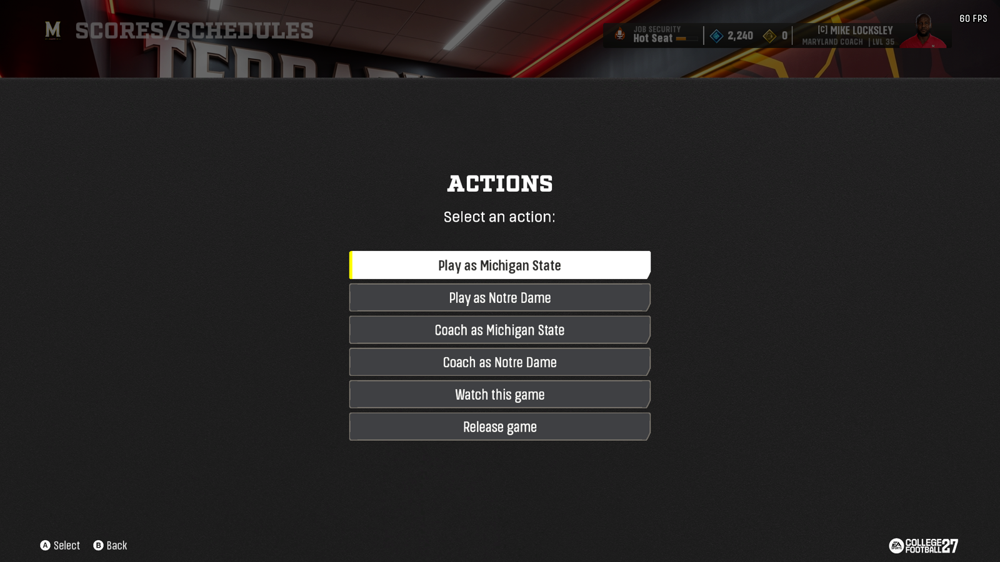
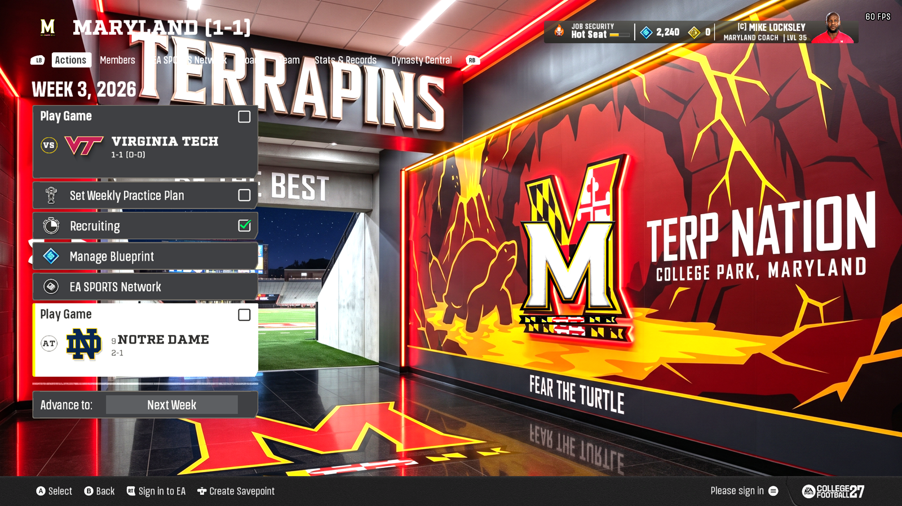
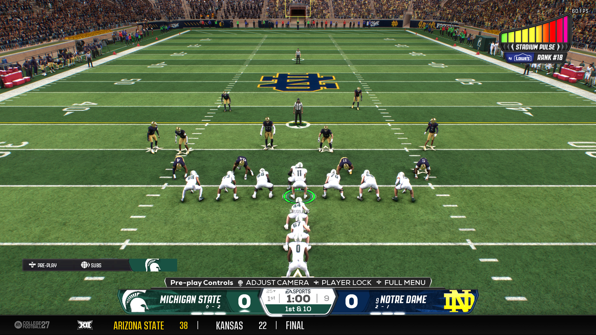
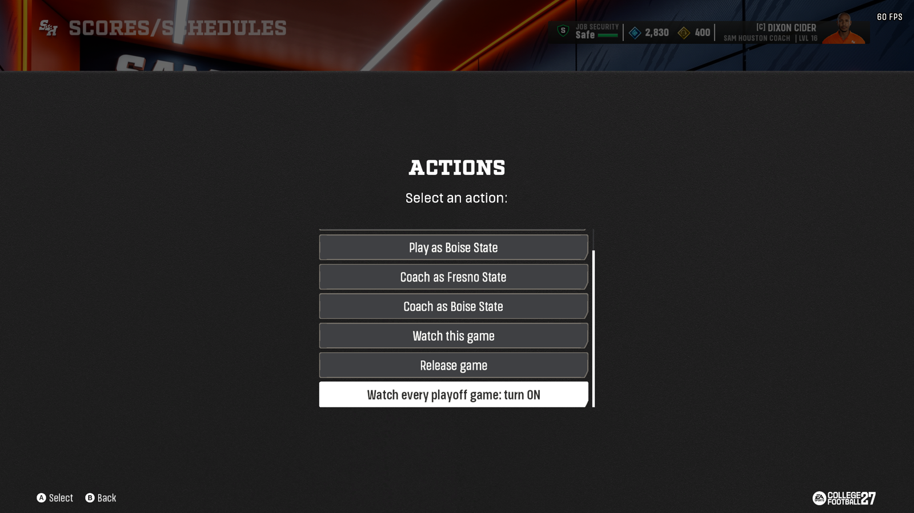

# Press Box

**Play, coach or watch any CPU-vs-CPU game in your dynasty, every week through the title game.**

Press Box is an add-on for College Football 27 dynasty mode. Pick any game between two computer teams, choose a side, and
choose how to take part. Your own team's game is never touched.

- **Play**: you take the controller for that team and play the game yourself.
- **Coach**: Coach Mode for that game only. You pick the plays, the computer snaps the ball.
- **Watch**: both teams are played by the computer and you watch.



## How to use it

1. On the dynasty hub go to **EA SPORTS Network > Scores / Schedules**.
2. Highlight a game this week between two computer teams and press **A** (Actions). You get the Press Box menu:
   - **Play as** (away team) / **Play as** (home team)
   - **Coach as** (away team) / **Coach as** (home team)
   - **Watch this game**
   - **Release game**
3. Pick one. The game shows up as a card on your hub right away.
4. Open the card and start the game the same way you start your own.





Good to know:

- **Change your mind:** pick another entry on the same game. It stays one card and switches to the new side or mode.
- **Release game** drops the card. That game is simmed like any other.
- **As many games as you like**, up to 15 extra games a week.
- **Games you took but didn't play** are simmed as normal when you Advance.
- **The result counts for the two computer teams only.** Your record, XP and coach record don't change.
- **Your own game:** press A on it and you get the game's normal Force Win popup, nothing from Press Box. This is the same
  in Scores / Schedules and on your Team Schedule, every week.

### The playoffs

From the conference championship week through the title game, the menu has one more entry: **Watch every playoff game:
turn ON**. With it on, every College Football Playoff game between two computer teams gets a Watch card as soon as each
round is set, through the title game. Pick **turn OFF** to stop. Your own playoff games are never touched.

You can still pick any postseason game yourself (championship games, bowls, playoff games): Play or Coach a game that already
has a Watch card and that card switches to your choice. The entry only shows from the championship week to the title game,
and your choice is kept for next season.



### Coming from 0.2.1

The old **Scouting** and **Game Prep** hub items are gone. The first time you Advance with this version they are cleared
from your save, along with any old picks. Nothing else to do.

## What's in the download

```
README.md                            this file
CHANGELOG.md                         what changed
Press-Box-Picker-0.6.3.fbmod         the menu mod (import it in the Mod Manager)
Manual install\Plugins\              the files that go in your Mod Manager's Plugins folder
```

## Requirements

- College Football 27 (PC) and the MMC Mod Manager. You launch the game from the Mod Manager.
- A dynasty.

## Install

1. Close the game and the Mod Manager.
2. Unzip the download anywhere.
3. Open the `Manual install\Plugins` folder from the download. Copy **everything in it** (`AnyGamePlugin.dll` and the
   `AnyGame` folder) into your Mod Manager's `Plugins` folder. That's the folder next to `MMCModManager.exe`. If there is
   no `Plugins` folder, create one. (Coming from 0.2.1: the plugin files are the same, you can skip this step.)
4. Start the Mod Manager and import `Press-Box-Picker-0.6.3.fbmod` (Import, or drag it in). It shows up in the Dynasty
   category as "Press Box Picker". Turn it on. Coming from 0.2.1: turn off or remove the old `Press-Box-Picker-0.2.4.fbmod`.
5. **Restart the Mod Manager** if it was open while you copied the files. It only loads plugins when it starts.
6. Launch the game from the Mod Manager as usual.

You end up with:

```
<Mod Manager>\Plugins\AnyGamePlugin.dll
<Mod Manager>\Plugins\AnyGame\   anygame.dll, anygame.ini (your settings), plugin.cfg, logs
```

## Settings

Settings are in `<Mod Manager>\Plugins\AnyGame\anygame.ini`. Open it in Notepad (`1` = on, `0` = off), save it, and
start the game. **The file is read once when the game starts, so change it with the game closed.**

| Setting | Default | What it does |
|---------|---------|--------------|
| `play` | 1 | Makes the games you take play properly: your coach, the right playbook, the right home or away side. Needed for everything else. |
| `modes` | 1 | Lets the menu choose Play, Coach or Watch. Leave it at 1. With 0 the Coach and Watch choices do nothing. |
| `watch` | 0 | 1 = every game you take is watched computer vs computer, whatever you picked. Normally leave at 0. |
| `coach` | 0 | 1 = every game you take is played in Coach Mode, whatever you picked. Normally leave at 0. |
| `exit_log` | 0 | 1 = write a line to the log whenever the game closes itself. Only for troubleshooting. |

Turn on only one of `watch` and `coach` at a time.

Your settings are never overwritten by copying a newer version over the old one (copy everything except
`anygame.ini` and `plugin.cfg`, or keep a backup).

## Known issues

- **Coach mode can sit for 2 to 5 minutes on a punt call before the computer snaps the ball.** It isn't frozen. Wait and it
  carries on by itself.
- **One dynasty-screen mod at a time.** Other mods that change the dynasty hub screens or the dynasty expression files
  (Playoff Customizer, Dynasty Customizer, Playoff Mode, DRI+ and the like) clash with Press Box. Use one of them, not both.
  In a dynasty that already holds Playoff Customizer data the Press Box menu does nothing. A Playoff Customizer compat patch
  is in testing.
- Never use **Super Sim > End Of Game** on a Press Box card. The game can close itself.
- The card after a game can show the score from the other team's side. It is cosmetic.
- **Watch mode:** a controller can rejoin a team from the pause menu. Back out of it and the computer keeps playing.
- Don't resume a quit Press Box game from a mid-game save.
- Press Box stays out of the way if another tool in your game already runs its own copy of this feature.

## Troubleshooting

Everything is in `<Mod Manager>\Plugins\AnyGame\`:

- `plugin.log`: whether the plugin loaded the DLL into the game. If it is missing or empty, the Mod Manager was open
  when you installed. Restart it and launch from it.
- `anygame.log`: what Press Box did in the game.
- `anygame-status.json`: the current state (`installed`, `idle`, `standing_aside` or `failed`, with the reason). Open it in
  Notepad.

Common cases:

- **No Press Box menu, only the normal popup:** check the mod is on in the Mod Manager. The menu shows on this week's
  unplayed games between two computer teams; your own game always shows the normal popup.
- **"access denied" in plugin.log:** the game runs as administrator. Run the Mod Manager as administrator too.
- **`failed` after a game update:** the game changed something. Look for a Press Box update. Your games stay normal.

When reporting a problem, send the three files above.

## Uninstall

Close the game and the Mod Manager. Delete `<Mod Manager>\Plugins\AnyGamePlugin.dll` and the
`<Mod Manager>\Plugins\AnyGame` folder, and turn off or remove the mod in the Mod Manager.
